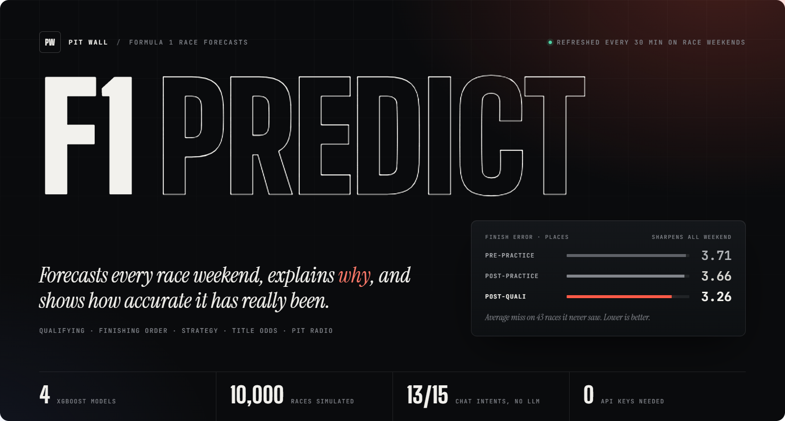
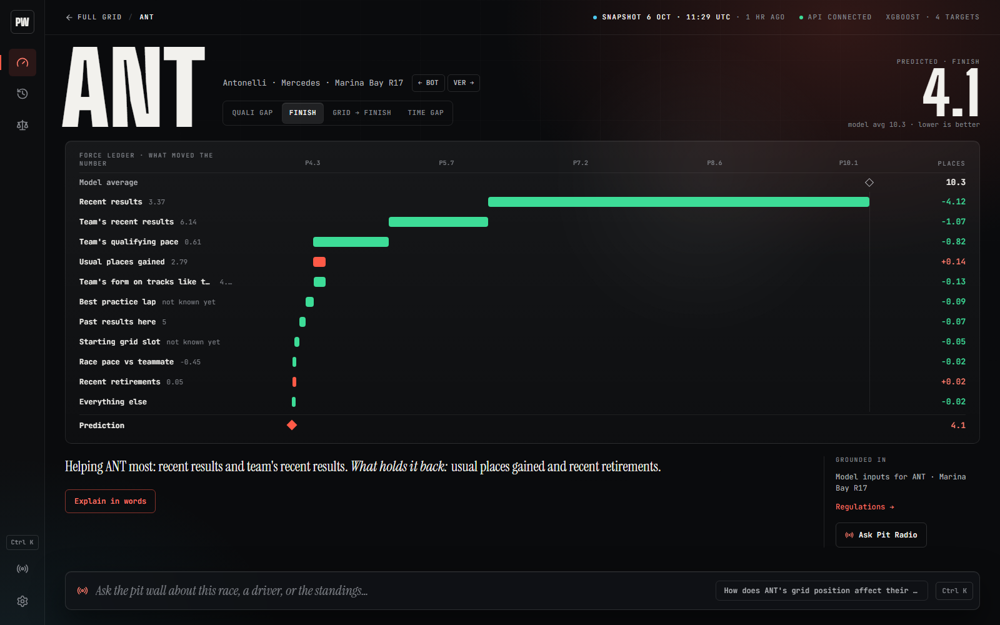
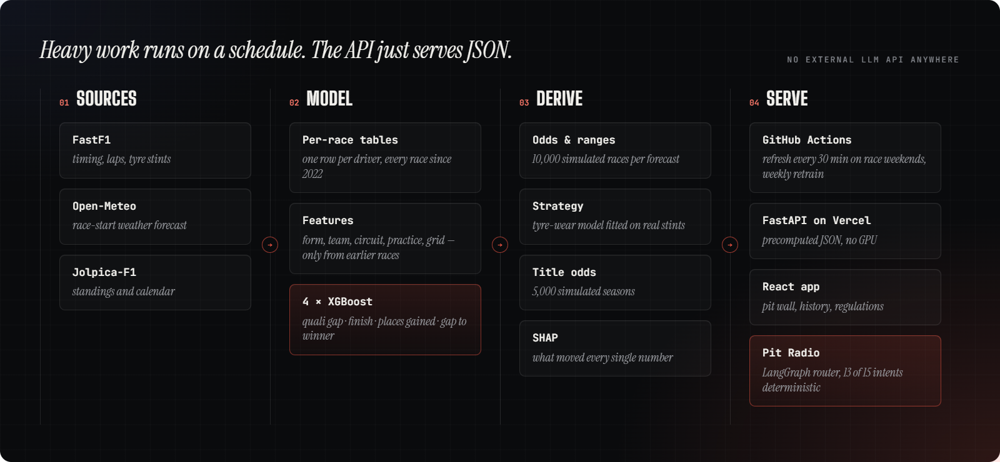

<p align="center">
  
</p>

<p align="center">
  
  
  
  
  
  
</p>

<p align="center">
  <a href="#what-it-does"><b>What it does</b></a> &nbsp;·&nbsp;
  <a href="#how-it-works"><b>How it works</b></a> &nbsp;·&nbsp;
  <a href="#accuracy"><b>Accuracy</b></a> &nbsp;·&nbsp;
  <a href="#run-it-locally"><b>Run it</b></a> &nbsp;·&nbsp;
  <a href="#deploying"><b>Deploy</b></a> &nbsp;·&nbsp;
  <a href="#api"><b>API</b></a> &nbsp;·&nbsp;
  <a href="#documentation"><b>Docs</b></a>
</p>

<br>

> *Most prediction content states a number with no reasoning. F1 Predict's "why" comes from the same model that made the prediction — every number traceable to real feature contributions and real FIA regulations, not vibes.*

<br>

<a id="what-it-does"></a>


For the next race, and for every past race the models have been tested on (since 2021):

| | Question | What you see |
|---|---|---|
| `01` | **Who takes pole?** | Predicted qualifying order and lap times, with each driver's chance of pole, of reaching Q3, and of going out in Q1 |
| `02` | **Who wins?** | Predicted finishing order; chances to win, podium and score; a likely finishing range, retirement risk, and gap to the winner |
| `03` | **Why?** | The inputs that pushed each prediction up or down — recent results, grid slot, practice pace, circuit, weather forecast — in plain words, plus a written explanation |
| `04` | **Best strategy?** | The fastest tyre plans, pit windows, and what a safety car on a given lap changes |
| `05` | **Who wins the title?** | Live standings with each driver's and team's chance of the championship |
| `06` | **Anything else?** | Pit Radio, an analyst chat: this weekend, the title fight, 75 years of results and records, the FIA rules. Every number is looked up, never remembered |
| `07` | **Can I trust it?** | For every past race: what it predicted beforehand next to what happened, and its error against simple guesses |

Forecasts refresh automatically through the weekend, sharpening after every practice session and again after qualifying. On sprint weekends they also update after Sprint Qualifying and after the Sprint, and on race morning once the FIA publishes the official grid with penalties. There's no *"not available yet"* — only *"less informed yet."*

<p align="center">
  
  <br>
  <sub><i>A driver's Why page: every prediction is one click from what moved it.</i></sub>
</p>

<br>

<a id="how-it-works"></a>




1. **Data** — One row per driver per race since 2018: grid, qualifying and practice times, the race-start weather forecast, result, gap to the winner, plus lap-by-lap tyre stints.
2. **Features** — Recent form, circuit history, team form and pace, the teammate comparison and circuit characteristics. Every one is computed only from earlier races, so nothing leaks from the future.
3. **One model per question, each the winner of a fair contest** — qualifying gap and finishing position are XGBoost + LightGBM averages, places gained is XGBoost, and gap to the winner is a two-part model (lapped or not). Each serves every weekend stage: trained on copies of past races with the not-yet-known information hidden. Every candidate model goes through the same walk-forward test (`experiments/`), and a change ships only if the early races choose it and the later ones don't say it's worse.
4. **Derived outputs** — Odds and ranges from 10,000 simulated races around the model's order. Lap times and race length from circuit history. Strategy from a tyre-wear model fitted on real stints.
5. **Explanations** — SHAP values show how much each input moved each prediction.

<details>
<summary><b>How the chat answers</b></summary>
<br>

**Fixed questions, no model.** A small classifier sorts each question into one of 14 kinds: the forecast, a head-to-head, standings, title maths, strategy, the rules, driver ratings and so on. It's a TF-IDF and logistic-regression model trained on 22,000 real-phrased questions. A plain data lookup then answers it, so these answers can't be made up. The classifier replaced keyword rules, which sent 45% of free-form questions to the wrong fixed answer ("how many races did Senna win?" got this weekend's forecast); it gets 2.6% wrong.

**Everything else, a local model that looks things up.** Open questions go to a fine-tuned **Qwen3.5 9B** running in Ollama on the owner's PC, as do the written "why" behind a prediction and history, records and background. The model picks lookups from 17 tools, Python runs them on the app's data, and the model writes the answer from the results:
- race results since 1950;
- computed records;
- the forecast, strategy and title odds;
- Wikipedia and the FIA rules.

An answer that mentions a number or name no lookup returned is replaced with the plain data answer before you see it. The model was fine-tuned on 25,000 conversations written from real lookup results. On 200 held-out questions it chose the right first lookup every time it was knowable (the untuned model: 79 of 97) and passed the checks 145 times to 89 (scores in [docs/MODELS.md](docs/MODELS.md)). Nothing at runtime calls a hosted model.

**Where the model isn't running** (the serverless deployment), the fixed questions still work and open questions get a plain answer, never an error. See [docs/MODELS.md](docs/MODELS.md).

</details>

<br>

<a id="accuracy"></a>


Every number below is from races the model had never seen: each was predicted by a model trained only on earlier races, exactly the way a live forecast is. The windows include the 2026 rule reset, the hardest period to predict.

<!-- ACCURACY:START (generated by scripts/readme_accuracy.py) -->

| Prediction | Model | Simple guess | Races it never saw |
|---|---|---|---|
| Finishing position *(after quali)* | **3.03** places | 3.28 · finish where you qualified | 53 races, Jul 2024 → Oct 2026 |
| Qualifying gap *(after practice)* | **0.72%** of a lap | 0.79% · team's recent gap | 76 races, Jul 2023 → Oct 2026 |
| Gap to winner *(after quali)* | **0.64%** of race time | 0.86% · typical past gap | 44 races, Nov 2024 → Oct 2026 |
| Win odds *(Brier, after quali)* | **0.027** | 0.046 · everyone equal | 53 races |

_Models trained 2026-10-20 on data through 2026-10-11. Lower is better for every number._

<!-- ACCURACY:END -->

The weekly retrain refuses to ship a model that doesn't beat its baseline or is clearly worse than the one it replaces, and rewrites this table. Full model cards — including where the models are weak — live in [docs/MODELS.md](docs/MODELS.md).

<br>

<a id="run-it-locally"></a>


Requires **Python 3.12+** and **Node 24**.

```bash
python -m venv .venv
.venv/Scripts/pip install -r requirements-dev.txt     # macOS/Linux: .venv/bin/pip
.venv/Scripts/python -m uvicorn src.api.main:app --reload

cd frontend && npm ci && npm run dev                  # → http://localhost:5173
```

That's it: no API key anywhere, and every fixed chat question already works.

<details>
<summary><b>Optional: open questions with the local chat model</b></summary>
<br>

Install [Ollama](https://ollama.com) and create the `f1-analyst` model from its GGUF file (how it is built: [training/README.md](training/README.md)). A 4 GB GPU with 16 GB of RAM runs it, at about 20 to 40 seconds per open answer.

```bash
ollama create f1-analyst -f Modelfile
```

No wiring needed: the backend finds it (`src/rag/llm.py`, `is_available()`), `/health` reports `chat_model: true`, and Pit Radio invites any F1 question.

</details>

<details>
<summary><b>Pipeline commands</b></summary>
<br>

| Task | Command |
|---|---|
| Forecast the next race now | `python -m src.models.refresh_job` |
| Ingest newly finished races | `python -m src.data.ingest --seasons 2026` |
| Race-weekend refresh + Monday ingest from a home connection (F1 live timing refuses GitHub's runners); opens a GitHub issue if it keeps failing | `scripts/refresh_local.ps1 -Python <python.exe>` · `-Ingest` · `-Register` installs both as scheduled tasks |
| Is the live forecast keeping up? (GitHub runs it every 2 h on race weekends, `freshness.yml`) | `python scripts/check_freshness.py` |
| Rebuild the feature table | `python -m src.features.build_dataset` |
| Retrain and evaluate all four models | `python -m src.models.train` *(~10 min)* |
| Refit blends, odds, history view, strategy | `python -m src.models.blend` · `python -m src.models.probabilities` · `python -m src.models.backtest_export` · `python -m src.strategy.model` |
| Car upgrades from the FIA's documents | `python -m src.data.fia --seasons 2026` |
| Is a retrained model clearly worse than the shipped one? (run before the history export) | `python -m src.models.regression_check` |
| Score every forecast the app published against the results | `python -m src.models.live_record` |
| Rebuild the regulations index | `python -m src.rag.corpus` |
| Chat in the terminal | `python -m src.agent.cli` |
| Refit the chat's question classifier (after new training conversations) | `python -m experiments.router_classifier --export` |
| Score a chat model on the held-out questions | `python -m training.eval_chat --models f1-analyst` |
| Tests | `python -m src.features.build_dataset` once, then `pytest` · `npm run lint && npm run build` in `frontend/` |

</details>

<br>

<a id="deploying"></a>


The API needs no model, no API key and no GPU to serve every fixed chat question and every other route. Open questions degrade to a plain answer, never an error.

**▸ Static + serverless (Vercel)** — One project serves the app and the API: the frontend builds to static files, `api/index.py` runs FastAPI as a Python function. Import the repo, keep the root as the repo root, deploy. No environment variables required. The API imports no pandas, XGBoost or torch — everything heavy is precomputed — so the function stays around 180 MB (cap: 250 MB) with short cold starts. Scheduled GitHub Actions commit fresh forecasts, and each commit redeploys; to serve new forecasts without redeploying, point `PREDICTIONS_DATA_SOURCE` at the raw GitHub URL of `data/predictions` (see `.env.example`).

**▸ Self-hosted, with the local model.** For open questions and the written "why", run the backend on a machine with Ollama and `f1-analyst` (see above). The same FastAPI process serves everything and calls Ollama on localhost. Set `FRONTEND_ORIGIN` if the app is served from another origin; cross-origin calls are refused otherwise.

<br>

<a id="api"></a>


| Route | Returns |
|---|---|
| `GET /predictions/latest` · `/predictions/{season}/{round}` | The forecast with odds, ranges, qualifying odds and lap times |
| `GET /predictions/{season}/{round}/explain?driver=&target=` | The SHAP breakdown behind one prediction |
| `GET /predictions/{season}/{round}/timeline` | How the forecast moved through the weekend |
| `GET /strategy/{season}/{round}?sc_lap=` | Tyre strategies, pit windows, safety-car scenario |
| `GET /championship` | Standings with simulated title odds |
| `GET /backtest/races` · `/backtest/{season}/{round}` · `/backtest/summary` | Past races, predicted vs actual, accuracy by season |
| `GET /model` | Held-out accuracy of each model |
| `GET /races?season=` | The calendar |
| `GET /regulations` · `/regulations/search?query=` · `/regulations/{file}` | FIA regulations and steward decisions |
| `GET /ratings` | Drivers ranked by qualifying pace with the car taken out |
| `GET /health` | Status, the forecast's age, and whether the local chat model is running (`chat_model`) |
| `POST /explain` | A written explanation of one prediction *(local model; 503 if absent)* |
| `POST /chat` | Pit Radio, streamed as server-sent events: fixed questions from data, open ones through the local model |

<br>

<a id="documentation"></a>


| Document | What's in it |
|---|---|
| [docs/MODELS.md](docs/MODELS.md) | Model cards — targets, inputs, accuracy, limits |
| [frontend/DESIGN.md](frontend/DESIGN.md) | The visual design system |

<br>

<p align="center">
  
</p>
